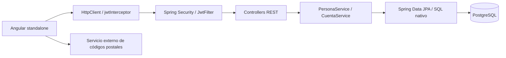
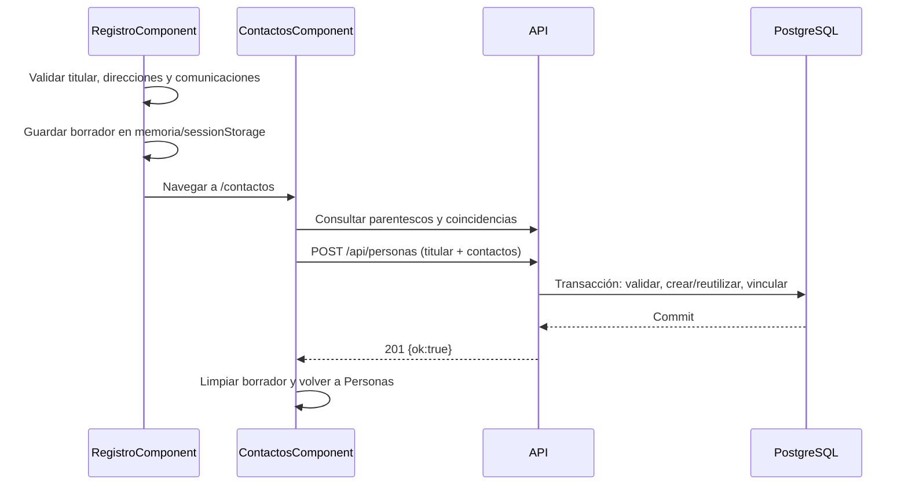

# Arquitectura y flujos internos

## 1. Topología

El frontend es una SPA con estado en memoria y almacenamiento del navegador. No hay SSR, backend proxy para códigos postales, WebSocket ni bus de eventos entre clientes. Los servicios raíz Angular permanecen vivos durante la navegación; una recarga destruye sus cachés.

## 2. Frontend

`app.config.ts` registra Router, detección de cambios por Zone y HttpClient con transporte XHR e interceptor funcional JWT. Las animaciones legacy se retiraron; Inicio y Dashboard usan `animate.enter` y CSS. Los componentes son standalone y declaran sus módulos Material. Los formularios de registro/contactos/cuenta son reactivos; el login usa `ngModel`. Las señales controlan carga, errores, selección y datos visibles; RxJS gestiona HTTP, deduplicación y comprobación de coincidencias.

`AppComponent` contiene RouterOutlet y el feedback global. Escucha `AuthService.tokenChanges$` y redirige a `/inicio` al perder el token fuera del login. `AdminLayoutComponent` proporciona sidenav, toolbar y datos de la cuenta. El menú es superpuesto hasta 760 px y persistente en escritorio. Sus subapartados se calculan desde la URL de edición de personas y contactos.

Los componentes convierten controles de formulario a DTOs; no deben enviarse directamente `FormGroup.value` ni propiedades visuales. Las fechas viajan como cadenas `YYYY-MM-DD`; los IDs son `number` en TypeScript y `Long` en Java.

## 3. Backend

| Paquete | Responsabilidad |
| --- | --- |
| `controller` | Mapping HTTP, cuerpos de respuesta, algunos mapeos manuales de excepciones y CORS |
| `service` | Validación explícita, coordinación de entidades, transacciones y construcción de DTOs |
| `repository` | CRUD JPA, búsqueda por comunicaciones, agregados, bloqueo y limpieza SQL |
| `model` | Entidades y relaciones persistentes |
| `dto` | Contratos de lectura/escritura; records excepto `PersonaDTO` |
| `security` | Firma/lectura JWT y población de `SecurityContextHolder` |
| `config` | Cadena de filtros, CORS, BCrypt y sesión stateless |

No existe `@ControllerAdvice` propio ni un formato único de error. Las entidades de catálogo se exponen directamente; las personas se representan mediante DTOs. No hay paginación en listados. El límite funcional de titulares reduce el volumen, pero no equivale a una garantía SQL.

## 4. Persistencia y transacciones

`Persona` contiene los datos comunes, correos, teléfonos y relaciones salientes. `PerfilTitular` usa PK compartida mediante `@MapsId`; almacena ocupación, baja y colección de direcciones. El contacto es otra `Persona`, no un objeto embebido con datos duplicados.

Las colecciones de personas usan cascada y `orphanRemoval`; en relaciones de emergencia, borrar el vínculo no aplica cascada REMOVE a la persona referenciada. La limpieza explícita ejecuta `eliminarContactoSinReferencias` después de `saveAndFlush`, dentro de la transacción.

Operaciones de escritura de `PersonaService` y `CuentaService` usan `@Transactional`; las lecturas principales usan `readOnly=true`. Ante una excepción no controlada dentro de una transacción se revierte la unidad de trabajo. Las escrituras confirman el resultado; PUT del titular también devuelve su PersonaResumenDTO para actualizar una fila sin consultar el listado completo.

`guardar` y `guardarContactos` adquieren `pg_advisory_xact_lock(74192301)`: un bloqueo global transaccional para serializar esos caminos de alta/sustitución/limpieza. No está presente en `reactivar` ni `actualizar`. Por tanto, no se debe describir el límite de 20 como protegido en todos los caminos concurrentes.

Las lecturas de listado usan consultas JPA de entidades y después DTOs; el resumen de red es reducido, pero **no** es una proyección SQL exclusiva de esas columnas. Correos y teléfonos usan `@BatchSize(32)`. La consulta de contactos evita ensamblar el grafo mediante SQL nativo y `string_agg(..., chr(31))`, con orden por IDs. Los agregados del dashboard usan `FILTER`, `EXISTS` y top 5 por ocupación.

## 5. Alta y edición

El primer paso del alta no crea una persona. El borrador usa la clave `registro_borrador`; JSON inválido se descarta. Logout elimina el borrador.

En edición, `/registro/:id` consulta `GET /api/personas/{id}` y bloquea guardado hasta cargar correctamente. Los campos `nombres`, `apellidoPaterno` y `apellidoMaterno` se normalizan a `nombre` y `apellido`; la división de apellidos usa espacios y no modela apellidos compuestos como entidades separadas. `cp` se transforma en `codigoPostal`.

La edición de un contacto conserva la lista original de vínculos y cambia el seleccionado. Los demás se envían como `{idContacto,idParentesco}`. Agregar concatena los nuevos a la lista original. Quitar envía la lista completa restante; no hay DELETE individual de contacto.

Las búsquedas de coincidencias usan `debounceTime(350)` y `switchMap`, y controlan revisiones para descartar respuestas/confirmaciones obsoletas. La reutilización confirmada bloquea los datos personales y envía solo ID/parentesco. Editar una persona compartida requiere confirmación y datos completos. El parentesco de los demás titulares no cambia.

## 6. Autenticación y resiliencia

El login busca `Usuario` por `username`, compara BCrypt y genera JWT HS256 con `sub=username`, `iat` y `exp` a una hora. `JwtFilter` verifica firma/vigencia al analizar el token y establece autenticación con autoridades vacías. No recarga la cuenta ni evalúa su rol o baja en cada petición.

`AuthService` almacena el JWT en `localStorage`, expone un `BehaviorSubject` y mantiene el perfil del header en una señal. La comprobación local decodifica `exp`; **no verifica criptográficamente** la firma. Los guards dependen de esa comprobación; la autoridad final es el backend.

Hay tres mecanismos de invalidación local: temporizador de vencimiento, evento `storage` y revisión del token en `localStorage` cada 250 ms. Este intervalo no realiza HTTP. Cambiar/cerrar sesión limpia perfil, consultas de cuenta, borrador y cachés de `PersonasService`.

El perfil se usa desde el login; al recargar, `/api/auth/me` lo recupera. Los cambios emiten `datosPersonalesActualizados$` con el ID afectado. AuthService compara ese ID con `usuarioActual.idPersona` y comprueba nombre completo/correo principal. Para un titular combina los campos persistidos del PATCH y aplica el perfil localmente, sin GET `/auth/me`; para un contacto compartido solo consulta el perfil si el cambio personal corresponde a la cuenta activa. Cambios de otra persona, dirección, teléfono, ocupación o correo secundario no refrescan el encabezado. `revisionCuenta` y comparación de token evitan que una respuesta anterior sobrescriba el perfil vigente.

`jwtInterceptor` afecta únicamente a URLs cuyo prefijo es `http://localhost:8080/api/`. Añade Bearer cuando existe token, aplica `timeout({each:15000})` y convierte TimeoutError a `HttpErrorResponse` con estado 0. Ante 401, 0 o 500–599 cierra sesión si el token actual coincide con el capturado al iniciar la solicitud. Propaga el error al consumidor. 400/403/404/409/422 no cierran sesión. Una caída no se detecta mientras no haya peticiones, y una respuesta obtenida de caché no prueba disponibilidad del backend.

## 7. Política de cachés

| Consulta | Persistencia | Deduplicación e invalidación |
| --- | --- | --- |
| Listado activo/inactivo y `/{id}/detalles` | Map en memoria, sin TTL | `shareReplay(1)`, `refCount:false`; edición de titular mantiene listados con una capa de filas actualizadas por ID y combina los campos modificados de sus detalles; alta, baja, reactivación, contactos y sesión limpian la caché completa; errores eliminan la entrada |
| `/{id}` para editar | Solo mientras la petición está pendiente | Map `solicitudes`, `finalize` elimina URL, `refCount:true`; no conserva la respuesta para futuras consultas |
| `/resumen` y `/ocupaciones` | Solo solicitudes pendientes | Mismo mecanismo anterior |
| `/{id}/contactos` | TTL de 30 s desde creación de la entrada | `shareReplay`, `refCount:false`; se limpia al actualizar personas/contactos o sesión; error elimina entrada |
| `/parentescos` | Memoria por sesión | `shareReplay`, sin TTL; se limpia al cambiar sesión o fallar |
| `/auth/me` | Señal del perfil y observable compartido | Revisión de cuenta/token al actualizar; limpia al cambiar sesión |

La capa `filasActualizadas` mantiene solo la versión más reciente por ID y se aplica al leer listados; evita cadenas de observables acumuladas y también cubre peticiones iniciales que terminen después del guardado. Las respuestas de escrituras iniciadas en otra sesión se descartan mediante `revisionSesion`. La señal del perfil compara ID/nombre/correo y no notifica por objetos equivalentes.

No hay IndexedDB, Service Worker, sincronización en tiempo real ni invalidación entre navegadores distintos. La invalidación elimina referencias del Map; no cancela automáticamente observables HTTP anteriores. Ver los límites de concurrencia y caché en la revisión técnica.

## 8. Diseño y accesibilidad

`styles.scss` importa el tema con `@use './material-typography'`. El tema Material 3 mantiene Azure/Blue, agrega Sora para títulos y Plus Jakarta Sans para texto, e incluye solo los módulos usados. Las variables `--app-font-*` unifican estilos locales; IBM Plex Mono se reserva para estadísticas y campos numéricos. `index.html` carga Google Fonts con `display=swap`, preconnect y familias de respaldo.

El feedback usa señales, avisos temporizados de 5 s y `<dialog>` nativo con `showModal()`, no `MatDialog`. El login y dashboard usan `animate.enter` con CSS y respetan `prefers-reduced-motion`. Formularios incluyen etiquetas, errores, estados de carga y atributos ARIA. Hay vistas móviles para Personas, Desactivadas y Contactos; la revisión de código no equivale a una auditoría de accesibilidad completa.

La edición del titular usa `PATCH /api/personas/{id}`. `PersonasService` conserva una copia del formulario cargado, compara los campos efectivos, omite la solicitud cuando no hay diferencias y envía las colecciones completas cuando cambian. La respuesta incluye los valores persistidos de los campos enviados y el servicio aplica deltas por ID al listado y detalles en memoria sin un GET adicional. El endpoint PUT completo sigue disponible para compatibilidad.
