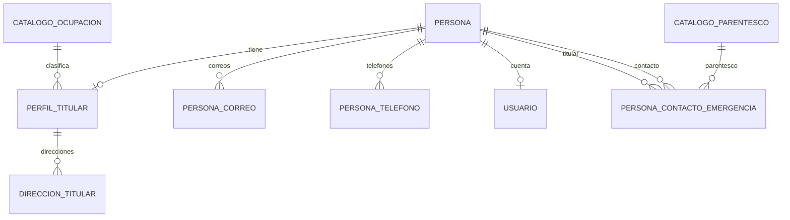

# Modelo PostgreSQL y persistencia JPA

## Fuente de verdad

La estructura documentada procede de `Backend/demo/src/main/resources/schema.sql`, contrastada con las entidades. El script usa `CREATE TABLE IF NOT EXISTS`: define tablas nuevas y no convierte una base de una versión anterior. No existe un sistema activo de migraciones Flyway/Liquibase ni una carpeta de migraciones SQL vigente.

Las direcciones se almacenan solamente en `direccion_titular`. `perfil_titular` no tiene `direccion` ni `ciudad`. La existencia del perfil distingue titular/contacto; `Persona.isTitular()` es un método derivado, no una columna.

## Relaciones

El SQL permite cero direcciones y cero contactos por perfil. Los mínimos de negocio se imponen en el servicio, no por esas cardinalidades SQL. Los vínculos son dirigidos; compartir persona no implica compartir parentesco.

## Diccionario de tablas

### `persona`

| Columna | Tipo | Restricción |
| --- | --- | --- |
| `id` | BIGSERIAL | PK |
| `nombre`, `apellido` | VARCHAR(100) | NOT NULL |
| `fecha_nacimiento` | DATE | NOT NULL |
| `genero` | VARCHAR(50) | NOT NULL |

Contiene datos comunes a titulares, contactos y administradores. No incluye comunicaciones, ocupación, baja ni indicadores de titular.

### `perfil_titular`

| Columna | Tipo | Restricción |
| --- | --- | --- |
| `id_persona` | BIGINT | PK y FK a `persona(id)`, ON DELETE CASCADE |
| `id_ocupacion` | BIGINT | NOT NULL; FK a `catalogo_ocupacion(id)` |
| `fecha_baja` | DATE | Nullable; NULL significa activo |

`PerfilTitular` usa `@MapsId`; la identidad coincide con `Persona.id`. Una baja no elimina las comunicaciones, direcciones ni relaciones.

### `direccion_titular`

| Columna | Tipo | Restricción/default |
| --- | --- | --- |
| `id` | BIGSERIAL | PK |
| `id_persona` | BIGINT | NOT NULL; FK a perfil, ON DELETE CASCADE |
| `orden` | INTEGER | NOT NULL |
| `pais` | VARCHAR(100) | NOT NULL; default México |
| `estado` | VARCHAR(100) | NOT NULL; default vacío |
| `municipio` | VARCHAR(100) | NOT NULL |
| `colonia` | VARCHAR(150) | NOT NULL; default vacío |
| `codigo_postal` | VARCHAR(5) | NOT NULL; default vacío; vacío o cinco dígitos |
| `calle` | VARCHAR(255) | NOT NULL |
| `numero` | VARCHAR(100) | NOT NULL; default vacío |

`ck_direccion_codigo_postal` usa regex PostgreSQL `^[0-9]{5}$`. Orden cero identifica la dirección principal. JPA ordena por `orden ASC, id ASC`. El servicio asigna `orden` desde la posición en el arreglo y reemplaza la colección; no expone un ID de dirección en el DTO. No hay UNIQUE `(id_persona,orden)`, CHECK de orden no negativo, máximo de 20 ni mínimo de una dirección en SQL.

### Comunicaciones

| Tabla | Columnas | Restricciones |
| --- | --- | --- |
| `persona_correo` | `id BIGSERIAL`, `id_persona BIGINT`, `correo VARCHAR(150)` | PK; FK CASCADE; correo/ID persona NOT NULL; UNIQUE `(id_persona,correo)` |
| `persona_telefono` | `id BIGSERIAL`, `id_persona BIGINT`, `telefono VARCHAR(10)` | PK; FK CASCADE; teléfono/ID persona NOT NULL; regex diez dígitos; UNIQUE `(id_persona,telefono)` |

No existe unicidad global de correo/teléfono. Un índice de búsqueda no equivale a una restricción UNIQUE. El correo se normaliza en el servicio, no mediante un trigger SQL. JPA ordena ambas colecciones por `id ASC`. Al sincronizar se eliminan valores ausentes y se agregan nuevos; no se reordenan todos los IDs según el nuevo payload. El correo principal del header es el primero por ese orden persistente.

### `persona_contacto_emergencia`

| Columna | Tipo | Restricción |
| --- | --- | --- |
| `id` | BIGSERIAL | PK |
| `id_persona` | BIGINT | NOT NULL; FK a persona, ON DELETE CASCADE |
| `id_contacto` | BIGINT | NOT NULL; FK a persona, ON DELETE CASCADE |
| `id_parentesco` | BIGINT | NOT NULL; FK a catálogo de parentesco |

`uq_pce_par` impide duplicar `(id_persona,id_contacto)`. `ck_pce_distintos` impide `id_persona=id_contacto`. SQL no obliga a que `id_persona` tenga un perfil titular; esa precondición corresponde al servicio. Los ManyToOne de la relación son LAZY y no hacen cascada REMOVE sobre contacto/parentesco.

### Catálogos y usuario

| Tabla | Columnas relevantes | Restricciones |
| --- | --- | --- |
| `catalogo_ocupacion` | `id BIGSERIAL`, `nombre VARCHAR(100)` | PK; nombre UNIQUE NOT NULL |
| `catalogo_parentesco` | `id BIGSERIAL`, `nombre VARCHAR(50)` | PK; nombre UNIQUE NOT NULL |
| `usuario` | `id BIGSERIAL`, `username VARCHAR(50)`, `password VARCHAR(255)`, `rol VARCHAR(20)`, `id_persona BIGINT` | PK; username UNIQUE NOT NULL; password NOT NULL; rol NOT NULL default ROLE_ADMIN; persona UNIQUE NOT NULL, FK CASCADE |

`Usuario.idPersona` es un Long, no una relación JPA. La cuenta obtiene su persona mediante un repositorio separado. `Usuario.username` declara longitud 50 en JPA; el servicio y el formulario también rechazan valores mayores antes de persistir, alineados con `VARCHAR(50)`.

El script incluye `ALTER TABLE usuario ADD COLUMN IF NOT EXISTS id_persona ... NOT NULL UNIQUE REFERENCES persona(id)`. No rellena datos antiguos; una tabla ya poblada sin esa columna puede rechazar el ALTER. No debe interpretarse como migración general de cuentas.

## Índices declarados

| Nombre | Expresión | Uso |
| --- | --- | --- |
| `idx_pce_persona` | `persona_contacto_emergencia(id_persona)` | Relaciones salientes |
| `idx_pce_contacto` | `persona_contacto_emergencia(id_contacto)` | Compartición y búsqueda de referencias |
| `idx_persona_correo_busqueda` | `persona_correo(lower(trim(correo)))` | Coincidencias normalizadas |
| `idx_persona_telefono_busqueda` | `persona_telefono(telefono)` | Coincidencias por teléfono |

PKs y UNIQUE producen sus propios índices. El esquema no declara índice dedicado sobre `direccion_titular(id_persona)` ni `perfil_titular(fecha_baja)`; no se ha medido un plan EXPLAIN en esta revisión.

## Semilla y secuencias

`data.sql` contiene 7 ocupaciones, 11 parentescos, 6 personas, 2 perfiles titulares, 2 direcciones principales, comunicaciones, 4 relaciones de emergencia y 2 cuentas. No se reproducen aquí nombres, comunicaciones, credenciales ni hashes de esas filas.

Las direcciones iniciales tienen calle/número/municipio; otros campos quedan vacíos para completar en edición. La UI actual es más estricta que el servicio y exigirá completar CP, estado y colonia.

Varios INSERT usan `ON CONFLICT`, pero las direcciones no tienen una clave de conflicto declarada para el par persona/orden. Reejecutar la semilla puede duplicarlas. El script debe ejecutarse una vez sobre una base nueva.

Se insertan IDs explícitos de persona, catálogos y cuentas. El script solo ejecuta `setval` sobre `persona_id_seq`; las secuencias de catálogos/usuario no quedan necesariamente alineadas. El alta implícita de una ocupación puede chocar con un ID sembrado. Ver [hallazgo R03](REVISION_TECNICA.md).

## DDL automático y alcance de verificación

La configuración versionada utiliza `spring.jpa.hibernate.ddl-auto=update`. Hibernate puede crear/ajustar estructuras, pero no es evidencia de que aplique los CHECK, índices y longitudes de `schema.sql` de forma idéntica. Por ejemplo, `PersonaTelefono` declara longitud 30 y SQL longitud 10.

La revisión contrastó código y scripts; no ejecutó recreación ni consultas de inspección sobre la base de desarrollo. Las pruebas de integración están condicionadas a una base local desechable y quedaron omitidas. No se afirma que la base instalada coincida con este diccionario.
